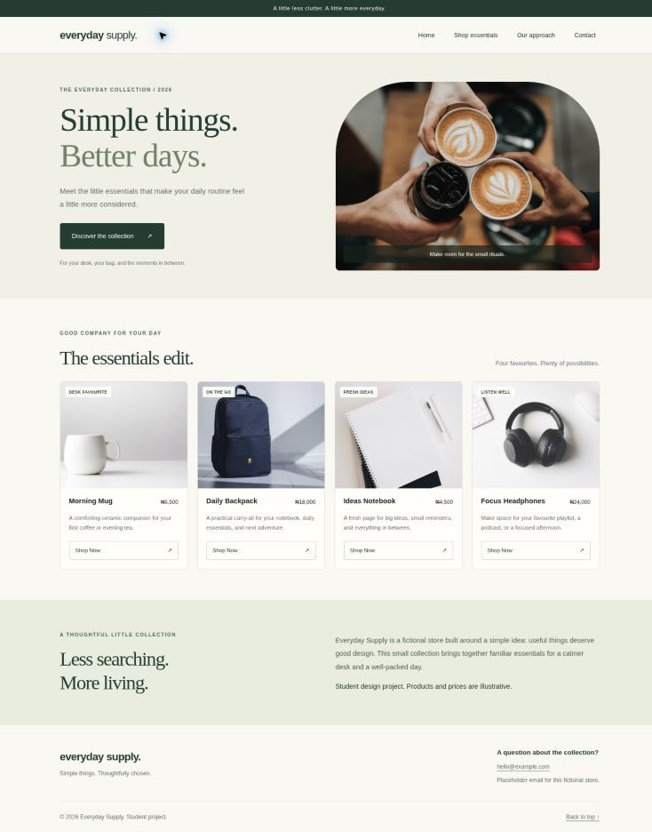
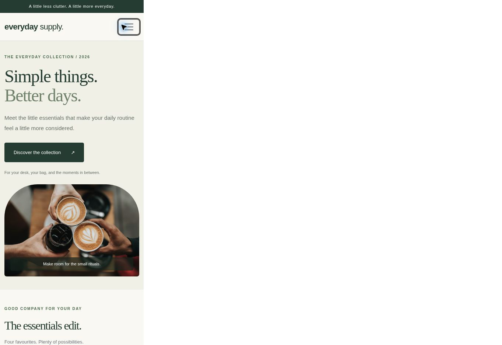

# Responsive Store Landing Page Checkpoint

Everyday Supply is a fictional online store built with semantic HTML, custom CSS, Bootstrap 5.3.3, and a small JavaScript file.

## Open locally

Download and extract the repository. Open `index.html` directly in your browser, or open the folder in VS Code and use Live Server. No npm installation is required. Internet access is needed for Bootstrap and Unsplash photos.

## Requirements included

- Header with section navigation and a collapsible Bootstrap mobile navbar.
- Hero, product collection, about section, and footer.
- Four product cards, each with a photo, name, description, price, and Shop Now button.
- CSS Grid and media queries: four columns on desktop, two on tablet, one on phone.
- Bootstrap cards and an accessible modal as additional library components.
- Comments explaining the layout and interactive code.

Shop Now opens a product preview with the selected name and price. This is a demonstration, with no real orders or payments. The contact email is an example placeholder.

## Design choices

Cream backgrounds, forest green accents, and generous spacing create a calm, coordinated store identity. Serif headings contrast with simple sans-serif body text. Product photos use consistent image areas, while aligned buttons keep cards easy to scan. Large touch targets, image descriptions, focus outlines, and reduced-motion support help accessibility.

## Screenshots

Actual browser captures are included below. The mobile image shows the store rendered inside a 390 px wide browser frame, with unused browser space to the right; it is a simulated phone viewport, not a physical phone capture.

### Desktop

### Mobile

## Validation

Checked desktop layout at 1363 px (four product columns, no horizontal overflow) and mobile frame at 390 px (one product column, no horizontal overflow). Checked mobile menu expansion, product modal display and dismissal, all five photo loads, internal navigation targets, four product cards, and JavaScript syntax.

## Files

- `index.html`: semantic content, Bootstrap components, and comments
- `styles.css`: custom styles and responsive media queries
- `script.js`: selected-product preview
- `screenshots/`: desktop and mobile captures

Photos are hosted on Unsplash. Bootstrap is loaded from jsDelivr.
